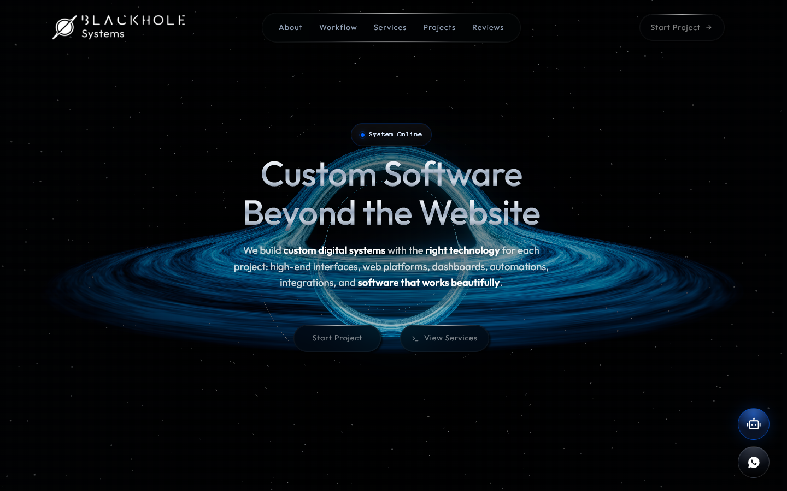
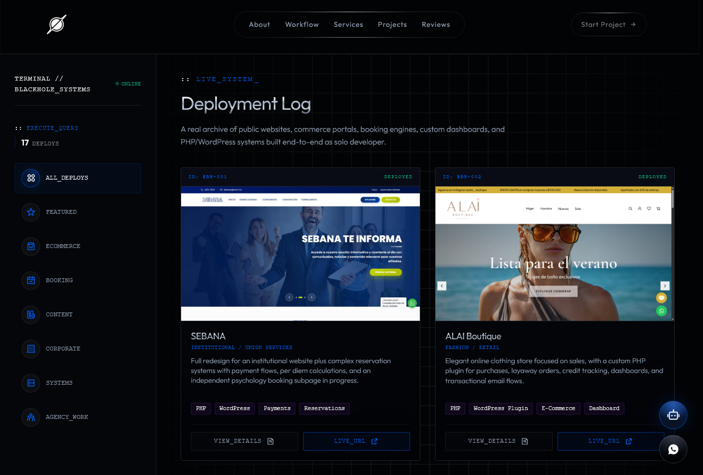
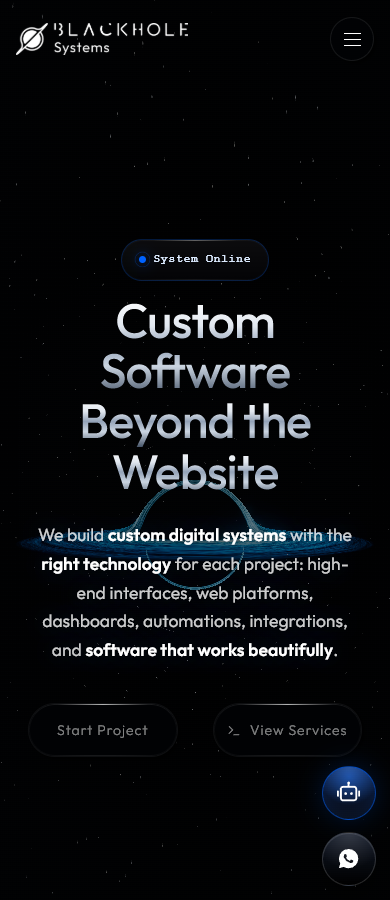
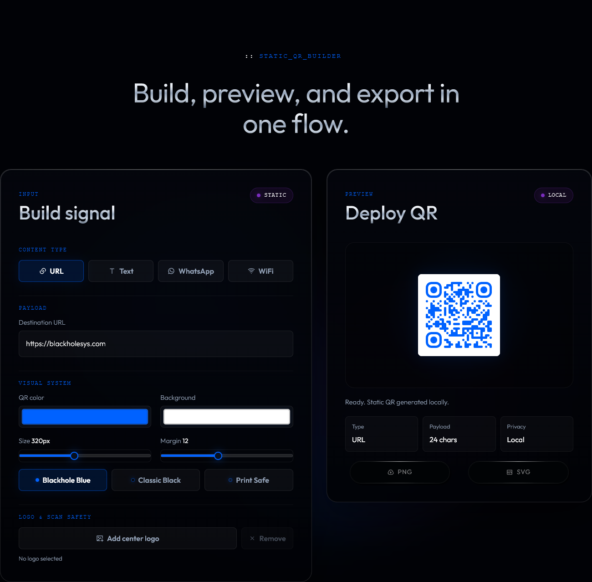

# Blackhole Systems

**Custom software, beyond the website.**

The public website and portfolio of Blackhole Systems: a developer-led studio building websites, commerce platforms, dashboards, automations and connected business systems. This repository also includes Blackhole QR Studio, a free browser-based utility.



## The Website

The site brings the studio's work, services and contact experience together in a responsive interface, with a cinematic 3D hero and a static fallback for unsupported browsers.

- **Project archive:** 17 public projects with real previews, filters, technical details and links to their websites.
- **Services and workflow:** custom interfaces, business software, integrations and automation, presented through the studio's visual identity.
- **Guided project assistant:** a local, rule-based advisor with English/Spanish follow-ups and conversation context. It does not use an external generative AI API.
- **Contact flow:** project inquiries through a quote form, plus contextual WhatsApp drafts for services and similar projects. Messages are reviewed and sent by the visitor.
- **Responsive interactions:** keyboard-aware navigation and modals, touch-enabled card tilt and viewport-aware motion.

### Deployment Log

The portfolio keeps its own curated public dataset. It is separate from the operational client records in the Blackhole Systems dashboard.



<details>
<summary>View the mobile landing</summary>

<p align="center">
  
</p>

</details>

## Blackhole QR Studio

A standalone tool at `/tools/blackhole-qr/`, sharing the website's visual language, loader and cursor without loading the landing's 3D scene.

- Generate static QR codes for **URLs, text, WhatsApp and WiFi**.
- Customize colors, size, margin and an optional center logo.
- Preview locally and export **PNG or SVG**.
- No account, watermark or server-side payload storage.

Static codes do not have a built-in expiration. A linked destination still needs to remain available.



## Under The Hood

The website is a static front end with no application bundler or production Node.js runtime.

| Layer | Implementation |
| --- | --- |
| Structure | HTML5 and semantic page sections |
| Styling | Modular CSS, shared brand tokens and page-specific styles |
| Behavior | Vanilla JavaScript with focused feature modules |
| 3D hero | Local Three.js/WebGPU renderer with image fallback |
| Typography and icons | Local Outfit fonts and a focused SVG sprite |
| Development checks | Node.js, Playwright and Sharp; development-only dependencies |

Landing and tools have separate bootstraps over shared components. Fonts, icons and media are local; effect lifecycles avoid unnecessary offscreen work without flattening each section's animation behavior. Project cards use responsive previews while detail modals retain the original images.

## Run Locally

From the repository root, use an HTTP static server rather than opening the HTML through `file://`. For example, with Python available:

```bash
python -m http.server 5500 --bind 127.0.0.1
```

- Website: <http://127.0.0.1:5500/>
- QR Studio: <http://127.0.0.1:5500/tools/blackhole-qr/>

Node.js is not needed just to serve the pages. Development checks require Node.js 22 or newer:

```bash
npm ci
npm run test:all
```

Browser tests use installed Google Chrome by default and intercepted local resources, without submitting real leads or messages. See [Development](docs/DEVELOPMENT.md) for browser setup, asset maintenance and deployment checks.

## Documentation

- [Architecture](docs/ARCHITECTURE.md): module ownership, boot order, CSS delivery, effects, media, tools and integrations.
- [Development](docs/DEVELOPMENT.md): local preview, verification, release workflow and static hosting checklist.
- [Screenshot notes](docs/images/README.md): capture scope and documentation-only image assets.
- [Icon maintenance](assets/icons/README.md) and [font provenance](assets/fonts/outfit/README.md): upstream sources, checksums and third-party licenses.

## Current Version

Website version: **1.0.18**

Deployment tag: `v1.0.18`

Release changes:

- Refresh the public README with real desktop/mobile, portfolio and QR Studio screenshots.
- Preserve the detailed implementation and verification reference in dedicated documentation.
- Keep website behavior, styling, animation and runtime assets unchanged; this is a documentation-only release.

The configured production domain is `blackholesys.com`. Hosting compression, cache behavior and physical-device performance still require validation on the actual deployment; local tests do not certify those conditions.

---

Built by [Bryan Pineda](https://github.com/bryanpineda-dev) for **Blackhole Systems**.
